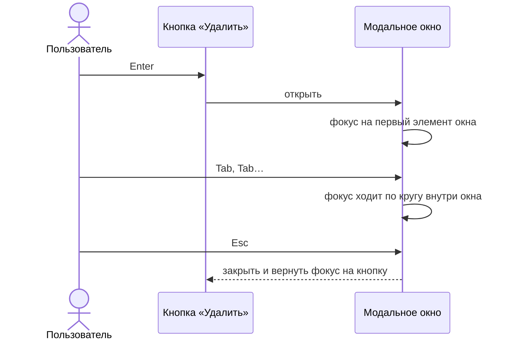
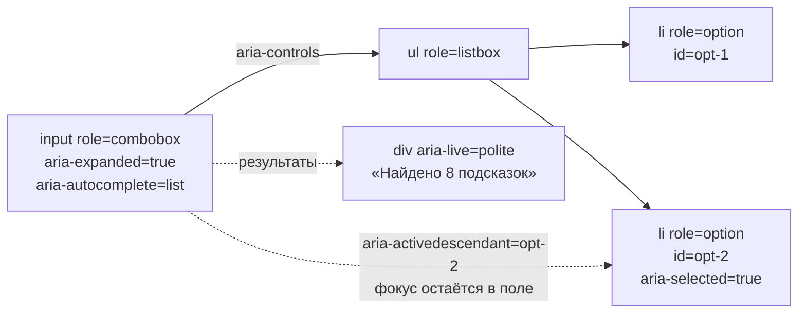

Интерфейс должен работать с клавиатурой, скринридером и при плохом зрении. Доступность не «для галочки»: на интервью её замечают сразу, потому что она показывает зрелость инженера. Начните с главного: **семантическая разметка**. `button`, `a`, `label`, `ul` уже умеют фокус, роли и клавиатуру. ARIA нужна, только когда нативного элемента нет, и неверный ARIA хуже его отсутствия.

## Базовые правила

- Любое действие доступно с клавиатуры, фокус виден и идёт в логичном порядке.
- У каждого поля есть метка (`label`), у иконки-кнопки есть доступное имя (`aria-label`).
- Информация не передаётся только цветом. Контраст обычного текста не меньше 4,5:1.
- Динамические изменения объявляются: `aria-live` для статусов и ошибок.
- Модальное окно захватывает фокус, закрывается по `Esc` и возвращает фокус на кнопку, которая его открыла.

## Паттерн combobox (автокомплит)

| Элемент    | Роль и атрибуты                                                                                                                             |
| ---------- | ------------------------------------------------------------------------------------------------------------------------------------------- |
| Поле ввода | `role="combobox"`, `aria-expanded`, `aria-controls` (id списка), `aria-autocomplete="list"`, `aria-activedescendant` (id выбранного пункта) |
| Список     | `role="listbox"`                                                                                                                            |
| Пункт      | `role="option"`, `aria-selected`                                                                                                            |

Клавиатура: `↓` и `↑` перемещают выбор, `Enter` подтверждает, `Esc` закрывает список. **Фокус остаётся в поле ввода**, а выбранный пункт обозначается через `aria-activedescendant`. Число найденных подсказок объявляется через `aria-live`: скринридер должен знать, что список обновился.

## Виртуализированные списки

Виртуализация ломает доступность: скринридер видит только отрисованные элементы. Нужны `aria-setsize` и `aria-posinset`, чтобы он понимал общий размер и позицию.

## Проверка

- Автоматические проверки (axe, eslint-plugin-jsx-a11y) ловят часть ошибок в CI.
- Остальное проверяется вручную: навигация клавишей `Tab`, работа с экранным диктором, масштаб текста до 200%.

## Точки выбора

| Точка            | Альтернативы                                                       | Вопрос-критерий                         |
| ---------------- | ------------------------------------------------------------------ | --------------------------------------- |
| Элемент          | Нативный (`button`) / ARIA на `div`                                | Есть ли нативный элемент для этой роли? |
| Фокус в combobox | Перемещается на пункты / остаётся в поле + `aria-activedescendant` | Нужно ли сохранять ввод при навигации?  |
| Проверка         | Только вручную / автоматика в CI + вручную                         | Сколько стоит регрессия доступности?    |

## Что сказать на интервью

«Автокомплит делаю по паттерну combobox: фокус остаётся в поле, выбор через `aria-activedescendant`, число результатов объявляю через `aria-live`. Нативные элементы использую там, где они есть, ARIA — только когда нужно. Автоматические проверки в CI ловят базовые ошибки, остальное проверяю вручную».
