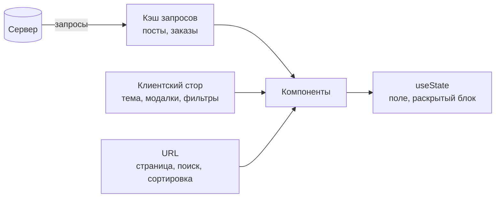
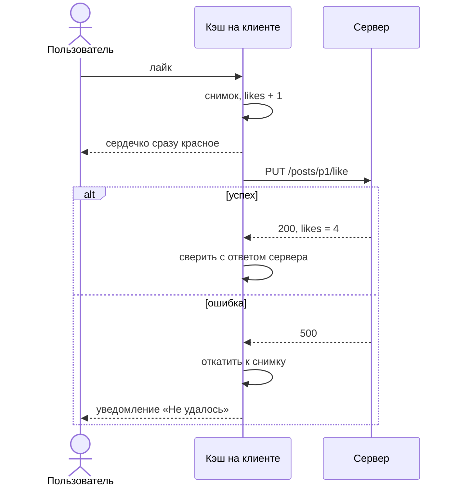
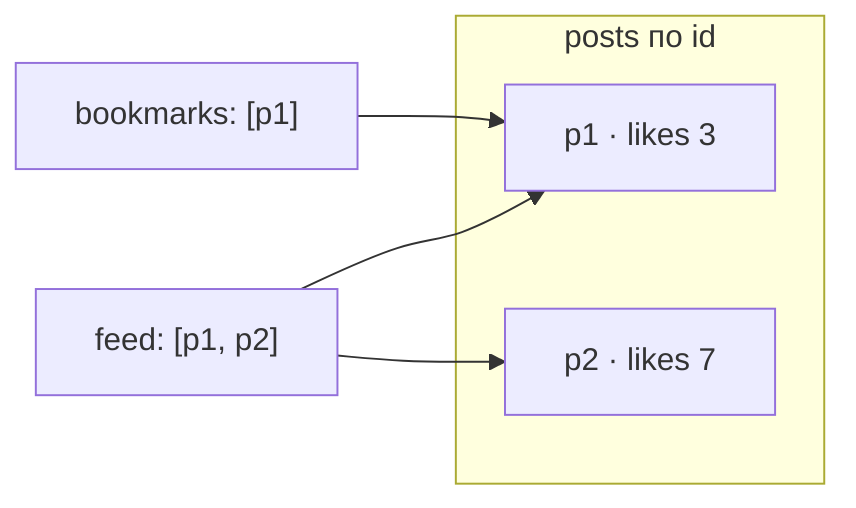

Большинство багов в интерфейсах — это не вёрстка, а **рассинхронизация данных**: устаревший список, двойной запрос, лайк, который «вернулся». Чтобы этого избежать, нужно различать виды состояния.

## Виды состояния

| Вид                          | Что это                                                      | Где хранить                               |
| ---------------------------- | ------------------------------------------------------------ | ----------------------------------------- |
| **Серверное** (server state) | Данные, которыми владеет сервер: посты, пользователи, заказы | Библиотека запросов (TanStack Query, SWR) |
| **Клиентское глобальное**    | Тема, открытые модалки, активные фильтры                     | Небольшое хранилище (Zustand, Redux)      |
| **Локальное**                | Значение поля, раскрытый блок                                | `useState` внутри компонента              |
| **Состояние URL**            | Страница, поиск, сортировка                                  | Адресная строка                           |



Главная ошибка — класть серверные данные в клиентское хранилище. Тогда вы сами пишете кэш, инвалидацию, повторные запросы и обработку гонок: всё то, что библиотека запросов делает за вас.

## Серверное состояние

Библиотека запросов решает типовые задачи:

- **Кэш по ключу.** Один запрос с одним ключом выполняется один раз, даже если его используют десять компонентов.
- **Свежесть.** Данные считаются свежими `staleTime`; устаревшие показываются сразу и обновляются в фоне (stale-while-revalidate).
- **Инвалидация.** После мутации помечаете ключи устаревшими, и данные перезапрашиваются.
- **Отмена и гонки.** Смена ключа отменяет прежний запрос.
- **Состояния загрузки и ошибки** из коробки.

## Мутации: обычные и optimistic

Обычная мутация: отправили, дождались, обновили кэш. Подходит, когда ошибка вероятна или задержка допустима.

**Optimistic update**: обновляем интерфейс сразу и откатываем при ошибке. Подходит для частых и почти всегда успешных действий (лайк, перемещение карточки). Нужно продумать три вещи: что показать при ошибке, как не потерять введённые данные и что делать с несколькими быстрыми действиями подряд.



## Нормализация

Одна сущность может быть в нескольких списках. Если хранить копии, они расходятся. Нормализация: сущности лежат в хранилище по id, а списки хранят только id.

```ts
posts: { p1: { id: "p1", likes: 3 } }
feed: ["p1", "p2"]
bookmarks: ["p1"]
```



Цена: нужны селекторы, которые собирают данные обратно, и аккуратная работа со ссылками (чтобы не перерисовывать весь список). Нормализуйте общие сущности и не усложняйте данные, которые встречаются в одном месте.

## Пагинация

| Способ           | Плюсы                                                | Минусы                                  |
| ---------------- | ---------------------------------------------------- | --------------------------------------- |
| **offset/limit** | Просто, можно перейти на страницу N                  | Дубли и пропуски, когда данные меняются |
| **Курсор**       | Стабильно для живых лент, быстро на больших таблицах | Нельзя перейти на страницу N            |

Для бесконечной ленты берут курсор. Для таблиц с переходом по номерам — offset. На клиенте страницы склеивают в один список и дедуплицируют по id.

## Источник правды

Для каждого значения должен быть **один владелец**. Если фильтр хранится и в URL, и в хранилище, они рано или поздно разойдутся. Правило: то, чем хочется поделиться ссылкой (поиск, сортировка, страница), живёт в URL; остальное — в состоянии приложения.

## Точки выбора

| Точка                  | Альтернативы                   | Вопрос-критерий                                                |
| ---------------------- | ------------------------------ | -------------------------------------------------------------- |
| Место серверных данных | Кэш запросов / глобальный стор | Нужны ли инвалидация и повторные запросы?                      |
| Мутация                | Обычная / optimistic           | Насколько вероятна ошибка и что видит пользователь при откате? |
| Пагинация              | offset / курсор                | Меняются ли данные во время чтения?                            |
| Структура списков      | Вложенные копии / нормализация | Встречается ли одна сущность в нескольких местах?              |

## Что сказать на интервью

«Серверные данные держу в кэше запросов, чтобы не писать инвалидацию руками. Клиентское состояние ограничиваю фильтрами и интерфейсом. Ленту грузим по курсору, страницы склеиваем и дедуплицируем; общие сущности нормализуем, чтобы лайк обновлялся во всех списках сразу».
