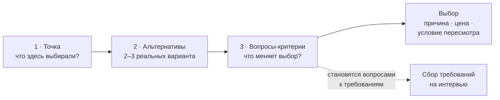

Системный дизайн — это умение **делать выбор и объяснять его**. Чтобы выбирать, нужно сначала видеть развилки. Многие разработчики идут по привычной дорожке и не замечают, что на ней есть поворот. Метод подготовки простой: научиться находить точки выбора, называть альтернативы и формулировать критерии.

## Что считается точкой выбора

Точка выбора — любое решение, которое могло быть принято иначе. Не обязательно крупное:

- куда класть файлы и как их называть;
- брать ли фреймворк, SSR или SPA;
- где хранить токен и нужна ли библиотека для дат;
- настроен ли CI/CD или выкладка делается руками.

Для лендинга точками будут структура папок, хранение в git, набор библиотек, сборщик, хостинг и способ деплоя. Для большого приложения список длиннее, но принцип тот же.

## Метод в три шага

1. **Найдите точки.** Возьмите приложение: своё или открытый проект. Цель — 30 и более точек, в идеале 50. Глубоких выводов не нужно: достаточно базовых решений.
2. **Для каждой точки назовите 2–3 альтернативы.** Если альтернатив нет, это тоже точка: спросите себя, почему вариант выбрали без сравнения.
3. **Сформулируйте вопросы-критерии.** По ним выбирают из альтернатив: какой размер проекта, нужна ли кастомная конфигурация, важна ли скорость разработки, сколько людей в команде, какие браузеры поддерживаем, планируется ли масштабирование.

Вопросы-критерии — основа сбора требований. Если на интервью вы задаёте вопросы, которые реально меняют выбор, требования становятся рабочими, а не формальными.

## Пример: три точки целиком

| Точка                    | Альтернативы             | Вопрос-критерий                                 |
| ------------------------ | ------------------------ | ----------------------------------------------- |
| Рендеринг первого экрана | CSR, SSR, SSG            | Нужно ли SEO? Как часто меняются данные?        |
| Сборщик                  | Webpack, Vite, Rspack    | Каков размер проекта? Важна ли скорость сборки? |
| Хостинг статики          | CDN-хостинг, свой сервер | Нужна ли серверная логика? Каков бюджет?        |

## Как показать выбор на интервью

Для каждой развилки три действия: назвать, сравнить, выбрать с причиной. Удобная формула: **выбор, причина, цена, условие пересмотра**. Например: «Беру SSR для ленты, потому что нужна индексация. Цена — нагрузка на сервер, смягчаю кэшем на CDN. Если ленту закроют авторизацией, SSR не нужен, и я пересмотрю решение».

## Частые ошибки

- **Проблема вместо точки.** Точка не обязана быть крупной проблемой; достаточно того, что здесь что-то выбирали.
- **Альтернатива-пугало.** Вариант, который никто всерьёз не выбрал бы, не даёт сравнения. Альтернативы должны быть реальными.
- **Выбор без критерия.** «Возьму React, потому что знаю» — это не обоснование. Нужен вопрос, который ведёт к выбору.

## Что сказать на интервью

«Метод я применяю к своему опыту: нахожу развилки, сравниваю альтернативы по вопросам-критериям и выбираю то, что подходит под требования. Так я объясняю не только итог, но и путь к нему».
