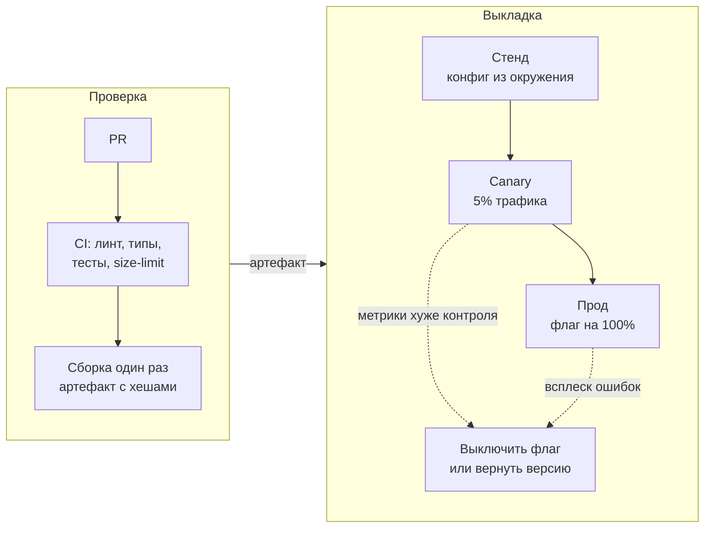
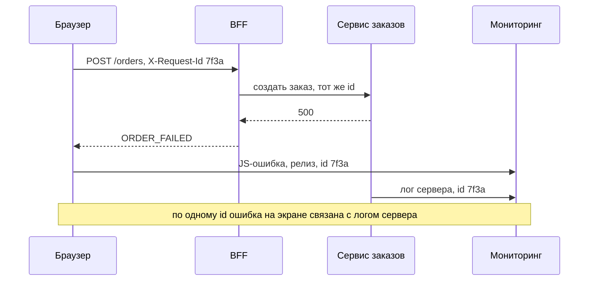

Архитектура фронтенда живёт не только в коде. На зрелом интервью почти всегда звучат три вопроса: как доставить изменение, как понять, что оно работает, и как откатить. Ответ на них показывает, что вы думаете о системе после запуска.

## CI/CD

- **CI** проверяет каждое изменение: линтер, типы, юнит-тесты, сборка и бюджет бандла (например, size-limit). Упавший CI блокирует слияние.
- **CD** собирает артефакт **один раз**: одна и та же сборка идёт на стенд и в прод. Конфигурация (адреса API, флаги) приходит из окружения, а не из пересборки.
- **Превью на каждый PR.** Дизайнер и продакт смотрят изменение до слияния.
- **Пирамида тестов.** Много быстрых юнит-тестов, меньше компонентных, немного e2e на критичных сценариях (вход, оплата). Чем больше e2e, тем дороже поддержка и медленнее CI.

## Релизная политика

- **Feature flags.** Код выкатывается выключенным и включается постепенно: процентом пользователей, регионом, группой. Так деплой отделяется от релиза.
- **Canary.** Новая версия получает часть трафика; метрики сравниваются с контрольной группой; при проблеме откат одним действием.
- **Откат.** Фронтенд откатить можно, только если API совместим с предыдущей версией клиента (см. статью «Архитектура фронтенда»).
- **Кэш и версии.** Файлы с хешем в имени и короткий срок для HTML. Старая вкладка после деплоя может не загрузить новый чанк: ловите эту ошибку и предлагайте перезагрузку.

## Командные процессы

- **Codestyle и линтеры** одинаковы для всех: prettier, eslint, правила импортов. Иначе ревью превращается в спор о пробелах.
- **Монорепо или несколько репозиториев.** Монорепо упрощает общие библиотеки и атомарные изменения; отдельные репозитории дают независимость команд. Решение зависит от числа команд и общего кода.
- **Владение кодом.** CODEOWNERS, правила ревью и слияния.
- **Общие зависимости.** Кто обновляет React и как координировать версии. Для микрофронтендов это критично (см. статью «Микрофронтенды»).

## Наблюдаемость

- **RUM** (real user monitoring): Web Vitals (LCP, INP, CLS) по устройствам, странам и версиям релиза.
- **Ошибки.** JS-ошибки с версией релиза и стеком, группировка, алерт на всплеск после выкладки.
- **Связь клиента и сервера.** Идентификатор запроса (correlation id) в заголовке, чтобы ошибку на экране связать с запросом на сервере.
- **Продуктовые метрики.** Доля ошибок загрузки, глубина прокрутки, конверсия по этапам.

## Надёжность интерфейса

- **Границы ошибок** (`ErrorBoundary`) не дают одному виджету уронить всю страницу. Ставьте их вокруг независимых блоков.
- **Состояния** загрузки, пустоты и ошибки проектируются заранее, а не «если останется время».
- **Деградация.** Если рекомендации не загрузились, основная функция продолжает работать.

## Точки выбора

| Точка       | Альтернативы                                 | Вопрос-критерий                                     |
| ----------- | -------------------------------------------- | --------------------------------------------------- |
| Выкладка    | Всем сразу / feature flags / canary          | Насколько рискован релиз и как быстро его откатить? |
| Окружения   | Одна сборка на все / пересборка на окружение | Есть ли секреты и адреса внутри бандла?             |
| Репозитории | Монорепо / несколько репозиториев            | Сколько команд и сколько общего кода?               |
| Мониторинг  | Только ошибки / RUM и продуктовые метрики    | Что для нас значит «работает»?                      |
| Тесты       | e2e на всё / пирамида                        | Сколько стоит поддержка e2e?                        |

## Что сказать на интервью

«Сборка одна: на стенды и в прод уходит одна и та же, конфигурация приходит из окружения. Новые экраны выкатываю за feature-флагом и включаю на процент пользователей, сравнивая Web Vitals и ошибки. Откат — выключить флаг или вернуть прежнюю версию, если API совместим. Бюджет бандла проверяю в CI».
