Секция проверяет не знание одной «правильной» архитектуры. Это разговор, в котором оценивают, как вы работаете с неопределённостью: задаёте ли вопросы, видите ли альтернативы, умеете ли объяснить выбор. Многие сильные инженеры проваливают её именно из-за формата, а не из-за знаний.

## Что на самом деле оценивают

Порядок примерно такой, и каждый пункт — отдельный навык:

1. **Сбор требований.** Превращаете ли размытую просьбу («сделай как YouTube») в конкретные функциональные и нефункциональные требования и отличаете ли одни от других.
2. **Технический кругозор.** Знаете ли точки выбора и альтернативы, можете ли обосновать стек.
3. **Верхнеуровневая архитектура.** Понимаете ли, из каких частей состоит система, где границы ответственности и как части связаны.
4. **Компонентная архитектура.** Как разбита страница, где состояние, как оно передаётся, какой API нужен этой странице.
5. **Дополнительно**, если остаётся время: производительность, безопасность, доступность, интернационализация.

Итог секции — не только оценка, но и профиль сильных и слабых сторон. Поэтому интервьюер ценит путь к решению выше, чем готовый ответ.

## Тайминг

Обычно 45–60 минут. Ориентир, который рекомендуют опытные интервьюеры:

| Этап                              | Время          |
| --------------------------------- | -------------- |
| Требования                        | 5–10 минут     |
| Высокоуровневый дизайн            | 10–15 минут    |
| Детализация компонентов и API     | оставшееся     |
| Производительность и безопасность | если успеваете |

```mermaid
gantt
  title План секции на 45 минут
  dateFormat HH:mm
  axisFormat %M мин
  section Требования
    5–10 мин :req, 00:00, 8m
  section Верхний уровень
    10–15 мин :arch, after req, 12m
  section Компоненты и API
    оставшееся :detail, after arch, 17m
  section Скорость, безопасность
    если успеваете :crit, after detail, 8m
```

Договоритесь о плане в начале: интервьюер может его скорректировать, и тогда вы знаете, что он ожидает.

## Что говорить и чего избегать

**Говорите так:** «Уточню требования…», «Есть два варианта, выберу первый, потому что…», «Цена этого решения — …», «Если нагрузка вырастет, пересмотрю…».

**Не говорите так:** «Я всегда делаю именно так», «Не знаю, как по-другому» и не молчите, пока думаете. Вслух проговаривайте ход мысли: это и есть то, что оценивают.

## Частые ошибки

1. **Не видят границ задачи.** Уходят в детали, где не специалисты: сравнивают Kafka и RabbitMQ или считают объём базы. Фронтенд-кандидату важнее показать, что он знает свою часть и границу с соседями.
2. **Готовятся по бэкендным материалам.** Книги о распределённых системах полезны, но они почти не покрывают компонентную архитектуру, состояние и производительность интерфейса.
3. **Собирают требования формально.** Задают вопросы из шаблона и не используют ответы в решении. Вопрос нужен, только если его ответ меняет выбор.
4. **Не показывают процесс.** Выдают готовую схему без развилок, альтернатив и обоснования.
5. **Узкий кругозор.** «Мы всегда деплоим в облако» или «я знаю только React» — без понимания альтернатив.

## Как готовиться

- Читайте материалы с фокусом на фронтенд: разборы фронтенд-интервью, курсы по фронтенд-системному дизайну, подборки схем.
- Разбирайте **своё** приложение и ищите в нём точки выбора (см. статью «Точки выбора: метод подготовки»).
- Тренируйтесь вслух, с таймером и на доске: инструмент для схем тоже нужно освоить, иначе он будет съедать время.

## Что сказать на интервью

«Сначала уточню, что мы проектируем: сценарии, масштаб и ограничения. Предлагаю план на 45 минут: требования, верхний уровень, детализация компонентов и API, и если успеем — производительность и безопасность. Вас это устраивает?»
