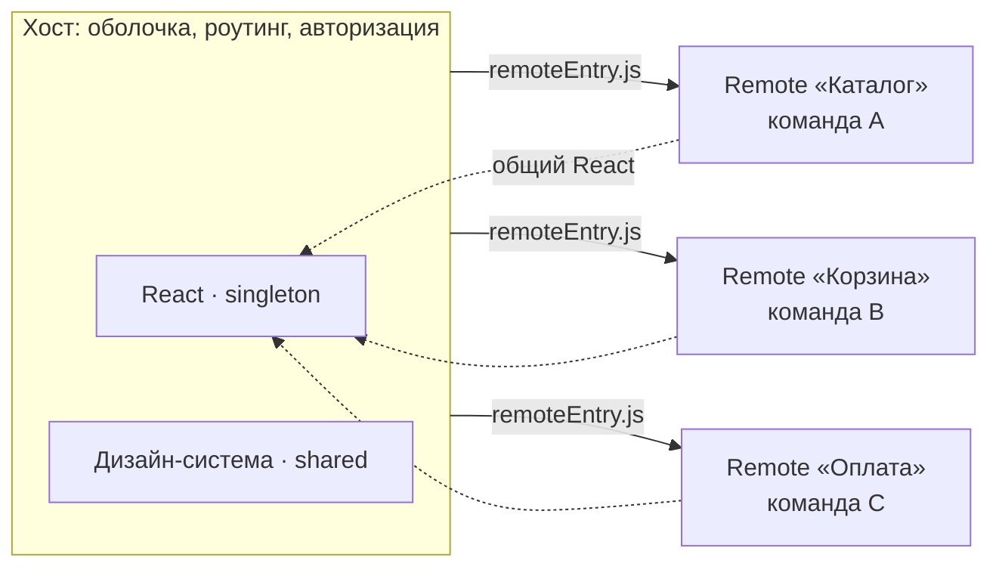

Микрофронтенды — разбиение фронтенда на части, которые собираются и выкладываются независимо, а в продукте работают как одно приложение. Это решение про **организацию команд**, а не про скорость. Его принимают, когда мешает общий релиз, а не потому, что модно.

## Зачем

- Несколько команд работают над одним продуктом и не ждут друг друга.
- Части продукта живут с разным темпом: каталог меняется каждую неделю, оплата — раз в квартал.
- Постепенная миграция: старый монолит и новый код работают рядом, пока переписывание не завершено.

## Цена

- **Общие зависимости.** Дубли библиотек, рассинхронизация версий React, разные дизайн-системы в разных частях.
- **Сквозные задачи.** Роутинг, авторизация, аналитика, состояние между частями приходится согласовывать.
- **Сборка и инфраструктура.** Больше пайплайнов, больше точек отказа.
- **Производительность.** Каждая часть тянет свой код; без бюджетов размер страницы растёт незаметно.
- **Без общих правил не работает.** Codestyle, версии зависимостей и релизная политика должны быть одни на все команды, иначе части расходятся.

## Способы склейки

| Подход                                    | Как работает                               | Плюсы                                 | Минусы                                       |
| ----------------------------------------- | ------------------------------------------ | ------------------------------------- | -------------------------------------------- |
| npm-пакеты (build-time)                   | Хост собирает опубликованные пакеты команд | Простота, типы                        | Связанные релизы: хост пересобирается        |
| **Module Federation** (Webpack 5, Rspack) | Хост загружает удалённые модули в рантайме | Независимые релизы, общие зависимости | Сложная конфигурация, совместимость `shared` |
| Iframe                                    | Изолированный документ на странице         | Полная изоляция стилей и кода         | UX, SEO, связь через `postMessage`           |
| Web Components                            | Кастомные элементы                         | Независимость от фреймворка           | Своя экосистема состояния, SSR сложнее       |

При Module Federation React обычно объявляют в `shared` как singleton: два экземпляра React на странице ломают хуки.

## Монолит или микрофронты

Прежде чем делить приложение, проверьте **модульный монолит**: один репозиторий, чёткие границы модулей по доменам, правило импорта только через публичный API модуля. Во многих случаях этого достаточно. Микрофронты оправданы, когда команд несколько и их релизы реально мешают друг другу.

## Что сказать на интервью

«Пока команд две и релизы синхронизированы, я бы взял модульный монолит с границами по доменам. Если команды начнут мешать друг другу, выделю части через Module Federation, React сделаю singleton, а общую дизайн-систему вынесу в пакет. Цена — сложнее сборка и сквозной роутинг, их нужно согласовать заранее».

## Точки выбора

| Точка             | Альтернативы                                      | Вопрос-критерий                                     |
| ----------------- | ------------------------------------------------- | --------------------------------------------------- |
| Единица деления   | Домен / страница / виджет                         | Кто владеет частью и как часто она меняется?        |
| Склейка           | npm / Module Federation / iframe / web components | Нужны ли независимые релизы и изоляция?             |
| Общие зависимости | Дубли / shared singleton                          | Есть ли библиотеки с глобальным состоянием (React)? |
| Роутинг           | Один роутер в хосте / свой у каждой части         | Нужны ли глубокие ссылки между частями?             |
| Монолит или микро | Модульный монолит / микрофронты                   | Сколько команд и насколько независимы релизы?       |
