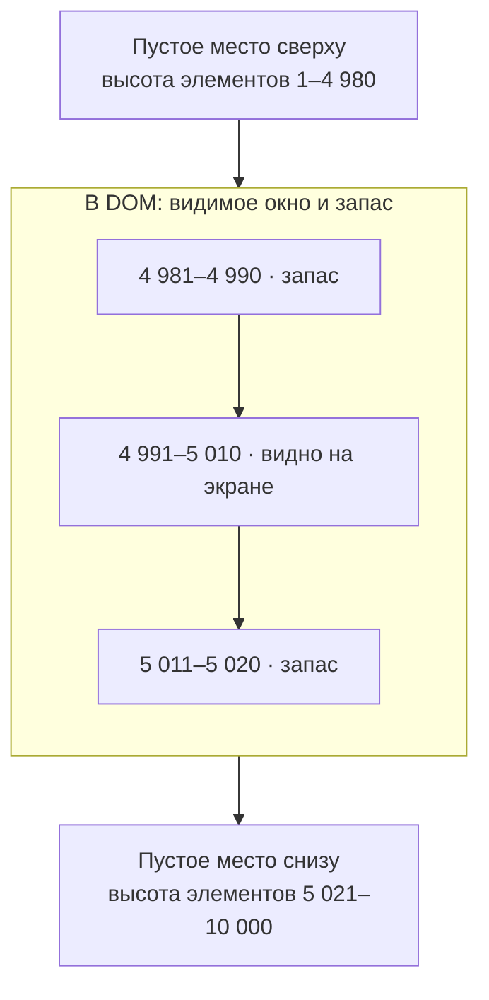

Производительность — это не «сделать быстро», а **измерить, найти узкое место и устранить его**. Без измерений оптимизации чаще вредят, чем помогают.

## Метрики, которые важны пользователю

| Метрика                             | О чём                                      | Хорошее значение |
| ----------------------------------- | ------------------------------------------ | ---------------- |
| **LCP** (Largest Contentful Paint)  | Когда появился главный контент             | до 2,5 с         |
| **INP** (Interaction to Next Paint) | Как быстро интерфейс реагирует на действия | до 200 мс        |
| **CLS** (Cumulative Layout Shift)   | Насколько «прыгает» вёрстка                | до 0,1           |

Дополнительно: **TTFB** (время до первого байта) и **TBT** (время блокировки основного потока). Измеряйте на реальных пользователях (RUM) и в лаборатории (Lighthouse): они дополняют друг друга.

## Загрузка

- **Разделение кода.** Страницы и тяжёлые компоненты загружаются по требованию (`React.lazy`, динамический `import()`). Маршрут не должен тянуть код чужих страниц.
- **Размер бандла.** Следите за бюджетом, анализируйте зависимости, убирайте дубли, заменяйте тяжёлые библиотеки.
- **Tree shaking.** Сборщик удаляет неиспользуемый код, но только у модулей с ES-импортами и без побочных эффектов. Помечайте пакеты `"sideEffects": false`, импортируйте именно нужную функцию, а не всю библиотеку.
- **Критический путь.** Что блокирует первый экран: шрифты, CSS, скрипты. Предзагрузка (`preload`), `defer`, отложенные сторонние скрипты.
- **Изображения.** Современные форматы (AVIF, WebP), адаптивные размеры (`srcset`), ленивая загрузка (`loading="lazy"`) для всего вне первого экрана и **явные размеры**, чтобы не было CLS.
- **CDN и кэш.** Статика с хешем и долгим `max-age`.

```mermaid
gantt
  title Загрузка первого экрана, секунды
  dateFormat x
  axisFormat %S.%L
  section Сеть
    HTML, TTFB :0, 300
    CSS и шрифты блокируют отрисовку :crit, 300, 700
    JS первого экрана, defer :700, 1300
    Чанки других страниц по требованию :done, 1800, 2400
  section Экран
    Первая отрисовка, FCP :milestone, 700, 700
    Главное изображение, preload :400, 1100
    Главный контент, LCP :milestone, 1100, 1100
    Гидратация занимает основной поток :crit, 1300, 1800
```

## Рендеринг и отзывчивость

- **Лишние перерисовки.** `React.memo`, `useMemo`, `useCallback` помогают, когда измерен реальный выигрыш. Часто достаточно переместить состояние ближе к месту использования.
- **Стабильные ссылки.** Новые объекты в props ломают `memo`; нормализованное хранилище сохраняет ссылки.
- **Тяжёлые вычисления.** Вынесите в Web Worker или разбейте на части, чтобы не блокировать основной поток.
- **Приоритеты.** `startTransition` и `useDeferredValue` отделяют срочные обновления (ввод) от несрочных (результаты фильтрации).

## Виртуализация длинных списков

Список из 10 000 элементов не нужно держать в DOM целиком. **Виртуализация** рендерит только видимую часть и небольшой запас, а остальное заменяет пустым пространством нужной высоты.

Цена: сложнее доступность (скринридеру нужны `aria-setsize` и `aria-posinset`), поиск по странице не видит скрытое, нужны размеры элементов (фиксированные или измеряемые). Если список короткий, виртуализация только усложняет.

## Сеть и данные

Кэш запросов, дедупликация, предзагрузка следующей страницы при приближении к концу списка, оптимистичные обновления. Меньше запросов и меньше данных: пагинация, выборка нужных полей.

## Как говорить об оптимизации

1. **Измерьте.** Назовите метрику и инструмент: «Профайлер показал…».
2. **Найдите причину.** Загрузка, рендеринг или сеть?
3. **Выберите самое дешёвое решение.**
4. **Проверьте результат** той же метрикой.
5. **Закрепите бюджетом в CI**, чтобы не откатиться назад.

## Точки выбора

| Точка              | Альтернативы                                 | Вопрос-критерий                                 |
| ------------------ | -------------------------------------------- | ----------------------------------------------- |
| Загрузка кода      | Всё в одном бандле / разделение по маршрутам | Что нужно на первом экране?                     |
| Мемоизация         | Без неё / `memo` и стабильные ссылки         | Измерен ли реальный выигрыш?                    |
| Длинный список     | Все элементы в DOM / виртуализация           | Сколько элементов и нужна ли поиск по странице? |
| Тяжёлые вычисления | Основной поток / Web Worker                  | Блокирует ли вычисление ввод пользователя?      |

## Что сказать на интервью

«Для ленты главные метрики — LCP и INP. Первый экран получает SSR и приоритетную загрузку главного изображения. Ленту виртуализирую, потому что она бесконечная; карточки мемоизирую и храню сущности нормализованно, чтобы лайк не перерисовывал список. Бюджет бандла контролирую в CI».
