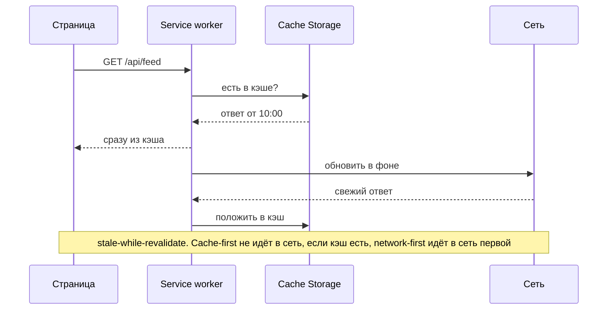
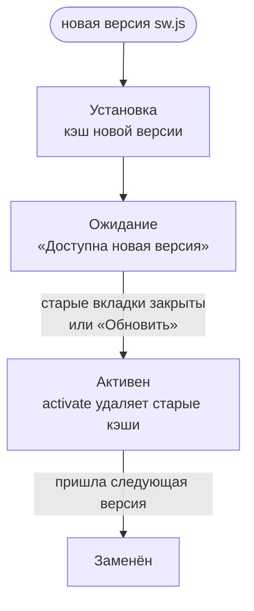

Progressive Web App — сайт, который ведёт себя как приложение: ставится на экран, открывается без сети. Для интервью важны три механизма, стратегии кэша и цена офлайна. Саму фичу выбирают осознанно: не всякому сайту нужен офлайн.

## Три механизма

- **Манифест** (`manifest.webmanifest`): имя, иконки, цвет темы, режим `standalone`. Без него установка на экран невозможна.
- **Service worker**: скрипт в фоне, который перехватывает сетевые запросы и управляет кэшем. Доступа к DOM у него нет, работает только по HTTPS (и на `localhost`).
- **Хранилища**: Cache Storage для HTTP-ответов и IndexedDB для данных и очереди действий. Статику и данные кэшируют по-разному.

## Стратегии кэширования

| Стратегия                  | Как работает                           | Подходит для                                  |
| -------------------------- | -------------------------------------- | --------------------------------------------- |
| **Cache-first**            | Сначала кэш, сеть только если его нет  | Статика с хешем в имени, шрифты               |
| **Network-first**          | Сначала сеть, кэш при ошибке           | HTML и API, где важна свежесть                |
| **Stale-while-revalidate** | Ответ из кэша сразу, в фоне обновление | Ленты, справочники, аватары                   |
| **Network-only**           | Без кэша                               | Платежи и всё, что нельзя показать устаревшим |

Stale-while-revalidate — тот же принцип, что в кэше запросов, только на уровне сети. Поэтому интервьюер часто спрашивает про него вместе с данными.

## Офлайн-интерфейс

- **Что видно без сети.** Кэшированная лента с пометкой «обновлено 2 часа назад». Пустой экран без пояснения — худший вариант.
- **Что можно делать.** Черновики и очередь действий в IndexedDB, отправка при восстановлении сети (см. статью «Сеть и real-time»).
- **Что нельзя.** Платежи и действия, которые требуют подтверждения сервера. Их показываем как «ожидает сети», а не как выполненные.

## Обновление service worker

- Новая версия ждёт, пока закроются старые вкладки. Иначе две версии кода будут работать одновременно и ломать друг друга.
- Пользователю предлагают обновиться («Доступна новая версия»), а не перезагружают страницу посреди ввода.
- Имена кэшей версионируют, старые удаляют при активации.

## Цена и когда не нужно

- Больше кода и тестов: сценарии офлайна, конфликты, миграции локальных данных.
- Ограничения платформ: например, iOS долго ограничивал push и фоновые задачи. Уточните аудиторию.
- Для внутреннего инструмента в офисе почти всегда хватает кэша API и не нужен полноценный PWA.

## Точки выбора

| Точка          | Альтернативы                                    | Вопрос-критерий                                      |
| -------------- | ----------------------------------------------- | ---------------------------------------------------- |
| Стратегия кэша | cache-first / network-first / SWR               | Насколько критична свежесть каждого ресурса?         |
| Офлайн-запись  | Нет / очередь в IndexedDB                       | Нужно ли создавать данные без сети?                  |
| Конфликты      | Последняя запись / слияние / выбор пользователя | Что будет, если два устройства правили одно и то же? |
| Установка      | Да / нет                                        | Нужны ли доступ с экрана и push?                     |

## Что сказать на интервью

«Статику с хешем в имени кэширую cache-first. Ленту — stale-while-revalidate с пометкой времени. В офлайне показываю кэш и очередь действий, платежи не выполняю. Service worker обновляю через waiting и предлагаю пользователю перезагрузиться».
