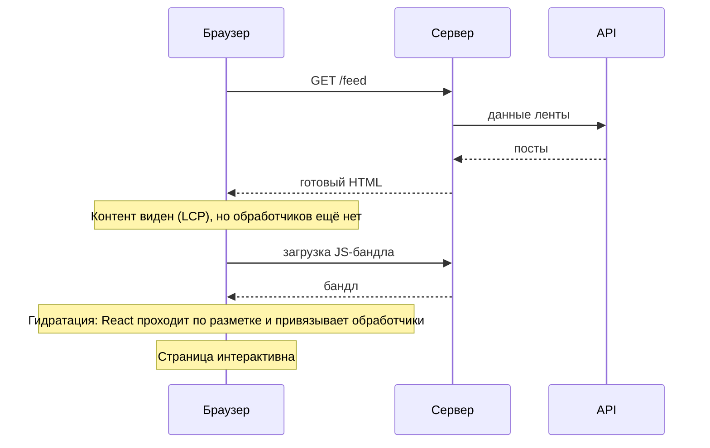
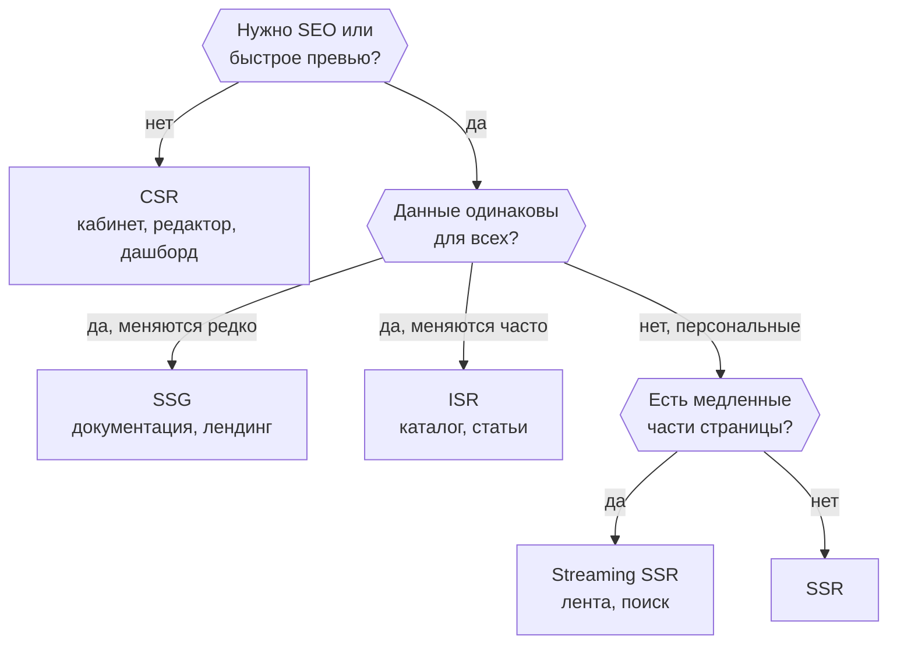

Выбор стратегии рендеринга влияет на скорость первого экрана, SEO, нагрузку на сервер и сложность разработки. Его принимают на этапе архитектуры и потом дорого менять.

## Основные стратегии

| Стратегия                                 | Где и когда строится HTML                                 | Сильные стороны                                                  | Слабые стороны                                                               |
| ----------------------------------------- | --------------------------------------------------------- | ---------------------------------------------------------------- | ---------------------------------------------------------------------------- |
| **CSR** (client-side rendering)           | В браузере, после загрузки JavaScript                     | Простая инфраструктура, богатая интерактивность                  | Пустой первый экран, слабое SEO без доработок, зависимость от размера бандла |
| **SSR** (server-side rendering)           | На сервере при каждом запросе                             | Быстрый первый экран, SEO, актуальные данные                     | Нагрузка на сервер, задержка до первого байта (TTFB), нужна гидратация       |
| **SSG** (static site generation)          | Во время сборки                                           | Мгновенная выдача с CDN, дёшево                                  | Данные устаревают до следующей сборки                                        |
| **ISR** (incremental static regeneration) | Статика, которая пересобирается по расписанию или событию | Скорость SSG и относительная свежесть                            | Окно устаревания, сложнее инфраструктура                                     |
| **Streaming SSR**                         | Сервер отправляет HTML по частям                          | Пользователь видит оболочку сразу, не дожидаясь медленных данных | Нужна поддержка в фреймворке, сложнее обработка ошибок                       |

Как это выглядит по времени для одной и той же страницы ленты (порядок величин, а не замер):

```mermaid
gantt
  title Когда пользователь видит контент, секунды
  dateFormat x
  axisFormat %S.%L
  section CSR
    Пустая HTML-оболочка :0, 150
    Загрузка и запуск JS :150, 900
    Запрос данных :900, 1500
    Контент виден (LCP) :milestone, 1500, 1500
  section SSR
    Рендер на сервере :0, 600
    Контент виден (LCP) :milestone, 600, 600
    Гидратация, кнопки не работают :crit, 600, 1300
  section Streaming SSR
    Оболочка уходит сразу :0, 200
    Посты дописываются потоком :200, 700
    Контент виден (LCP) :milestone, 700, 700
    Гидратация :crit, 700, 1300
  section SSG и ISR с CDN
    HTML из кэша CDN :0, 100
    Контент виден (LCP) :milestone, 100, 100
    Гидратация :crit, 100, 800
```

## Гидратация

После SSR браузер получает готовый HTML, но он ещё «мёртвый»: обработчики событий не привязаны. **Гидратация** — это проход React по готовой разметке: он строит дерево компонентов и привязывает обработчики. Из этого следуют два правила:

- Разметка на сервере и на клиенте должна совпасть. Случайные значения, `Date.now()` и проверки `window` в рендере приводят к ошибкам гидратации.
- Гидратация стоит CPU. Чем больше интерактивного кода на странице, тем дольше страница «не реагирует» после показа. Частичная гидратация и серверные компоненты уменьшают эту цену.

## Как выбирать

Задайте себе вопросы:

1. **Нужно ли SEO и быстрое превью в соцсетях?** Если да, CSR в чистом виде не подходит.
2. **Как часто меняются данные и одинаковы ли они для всех?** Одинаковые и редкие: SSG/ISR. Персональные: SSR или CSR с кэшированием API.
3. **Что важнее: первый экран или интерактивность после?** Лендинг и каталог против редактора или дашборда.
4. **Какая инфраструктура доступна?** SSR требует работающего сервера, SSG — только CDN.

Гибрид — норма. Типичная схема: оболочка и публичные страницы статические или серверные, а персональные данные подгружаются на клиенте после показа. Этот приём развивается в **частичный пре-рендеринг**: статическая оболочка отдаётся сразу, а динамические части страницы заполняются потоком.

## SPA или SSR: пример выбора

Для маркетплейса каталог и карточки товаров нужно индексировать, поэтому их рендерят на сервере. Личный кабинет, корзина и оформление заказа не индексируются, их можно оставить SPA: интерактивность важнее первого байта. Граница проводится по маршрутам, а не на всё приложение.

## Островная архитектура и серверные компоненты

Не вся страница интерактивна. Статья, шапка и подвал не требуют JavaScript на клиенте. **Серверные компоненты** (React Server Components) выполняются только на сервере и не попадают в бандл. **Островная архитектура** гидратирует только интерактивные острова. В обоих случаях идея одна: отправлять клиенту меньше кода.

## Влияние на метрики

- **TTFB.** SSR добавляет время на сервере; SSG/ISR с CDN даёт самый быстрый первый байт.
- **LCP.** SSR и SSG обычно улучшают его, потому что контент уже в HTML. Для CSR LCP ждёт выполнения JavaScript и запроса данных.
- **INP.** Тяжёлая гидратация и большой бандл ухудшают отзывчивость.

## Точки выбора

| Точка                   | Альтернативы                              | Вопрос-критерий                                           |
| ----------------------- | ----------------------------------------- | --------------------------------------------------------- |
| Первый экран            | CSR / SSR / SSG / ISR                     | Нужно ли SEO? Одинаковы ли данные для всех пользователей? |
| Граница рендеринга      | На всё приложение / по маршрутам          | Какие страницы индексируются, а какие интерактивны?       |
| Гидратация нижней части | Полная / островная / серверные компоненты | Сколько интерактивного кода на странице?                  |

## Что сказать на интервью

«Для публичной ленты, которой важна индексация, я бы взял SSR с потоковой выдачей: оболочка уходит сразу, посты подгружаются по мере готовности. Цена — нагрузка на сервер и гидратация; смягчаю кэшированием на CDN и ленивой гидратацией нижней части страницы. Для личного кабинета хватит CSR: SEO не нужно, а интерактивность важнее».
