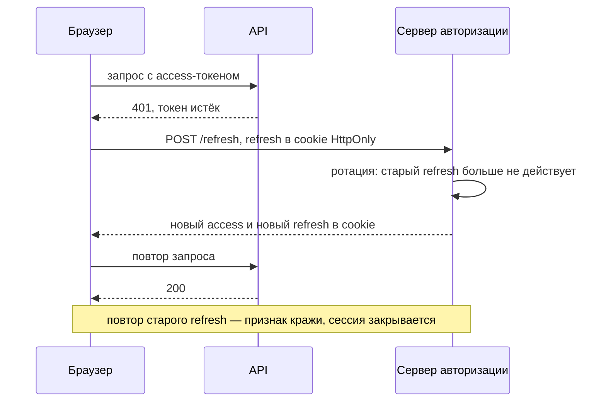
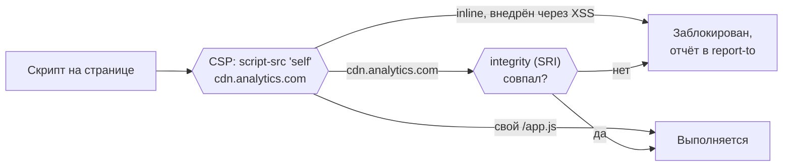
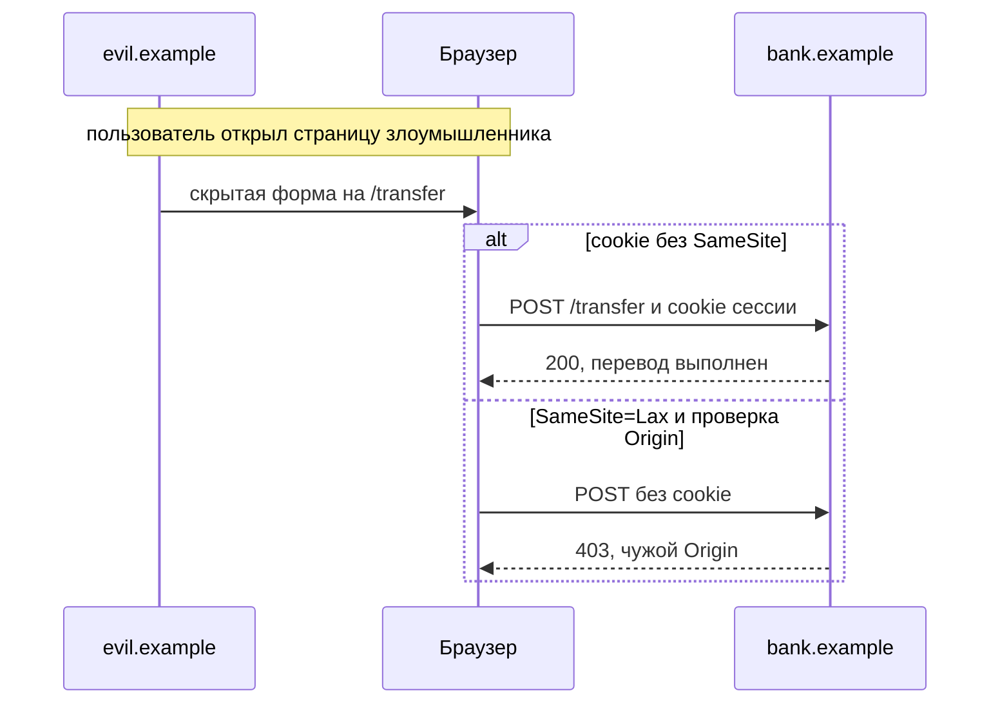

Безопасность фронтенда — это защита пользователя от чужого кода на странице и от запросов, которые не должны были произойти. Главное правило: **браузер пользователя не доверенная среда**. Любую проверку, сделанную на клиенте, повторяйте на сервере.

## Аутентификация и токены

Типовая схема: логин → сервер выдаёт короткоживущий access-токен и долгоживущий refresh-токен → access уходит с каждым запросом → при истечении обновляется через refresh.

| Место хранения                            | Плюсы                   | Риск                                                 |
| ----------------------------------------- | ----------------------- | ---------------------------------------------------- |
| `localStorage`                            | Просто                  | Любой XSS читает токен                               |
| Cookie `HttpOnly` + `Secure` + `SameSite` | Скрипты не читают токен | Нужна защита от CSRF (`SameSite`, проверка `Origin`) |
| Переменная в памяти                       | Не сохраняется на диске | Теряется при перезагрузке; нужен refresh             |

Для сессий надёжнее `HttpOnly`-cookie. Refresh-токен храните только в такой cookie с ограниченным путём. Используйте **ротацию**: при каждом обновлении старый refresh-токен инвалидируется, а его повторное использование считается признаком кражи, и сессия закрывается.

## XSS (межсайтовый скриптинг)

Злоумышленник внедряет скрипт, который выполняется с правами пользователя на вашем сайте.

- React экранирует значения в JSX. Опасны `dangerouslySetInnerHTML`, `innerHTML` и `href` со значением `javascript:`.
- Если нужен пользовательский HTML, пропускайте его через санитайзер (например, DOMPurify) с белым списком тегов.
- Не собирайте HTML и URL строками из пользовательских данных.

## CSP, CORS и заголовки

- **Content Security Policy** задаёт, откуда можно загружать скрипты и стили. Запрет inline-скриптов (или nonce) — вторая линия защиты от XSS.
- **CORS** управляет тем, какому origin браузер разрешит **читать** ответ. Это не защита сервера от запросов. Не ставьте `Access-Control-Allow-Origin: *` вместе с credentials.
- **Заголовки:** `Strict-Transport-Security` (только HTTPS), `X-Content-Type-Options: nosniff`, `Referrer-Policy`, `frame-ancestors` в CSP против clickjacking.

## CSRF

Если аутентификация идёт через cookie, браузер отправит её и с чужого сайта. Защита: `SameSite=Lax` или `Strict`, проверка заголовка `Origin` для небезопасных методов, при необходимости CSRF-токен.

## Сторонние скрипты и зависимости

- Аналитика и чат-виджеты исполняются с вашими правами. Ограничьте их через CSP, подключайте с **Subresource Integrity** (`integrity`) и не отдавайте данных больше, чем нужно.
- Зависимости: `npm audit`, Dependabot или Renovate, lock-файл. Новый пакет проверяйте до установки: это часть защиты от атак на цепочку поставок.

## Права и утечки

- Права проверяются на сервере. Скрытая кнопка — не защита.
- Токены в query string попадают в историю браузера и логи серверов: передавайте их в заголовках.
- Не пишите чувствительные данные в логи, URL и аналитику.

## Точки выбора

| Точка             | Альтернативы                                      | Вопрос-критерий                                               |
| ----------------- | ------------------------------------------------- | ------------------------------------------------------------- |
| Хранение токена   | localStorage / HttpOnly-cookie / память           | Что случится, если скрипт на странице будет скомпрометирован? |
| Защита от XSS     | Санитайзер / CSP / оба                            | Есть ли пользовательский HTML?                                |
| Сторонние скрипты | Без ограничений / CSP + SRI / self-host           | Какие данные им видны?                                        |
| Сессия            | Фиксированный срок / скользящая / ротация refresh | Насколько критична кража сессии?                              |

## Что сказать на интервью

«Токен держу в HttpOnly-cookie, скрипты его не читают. От XSS защищаюсь React-экранированием, санитайзером для пользовательского HTML и CSP без inline-скриптов. Права всё равно проверяю на сервере. Сторонние скрипты ограничиваю CSP и подключаю с SRI».
