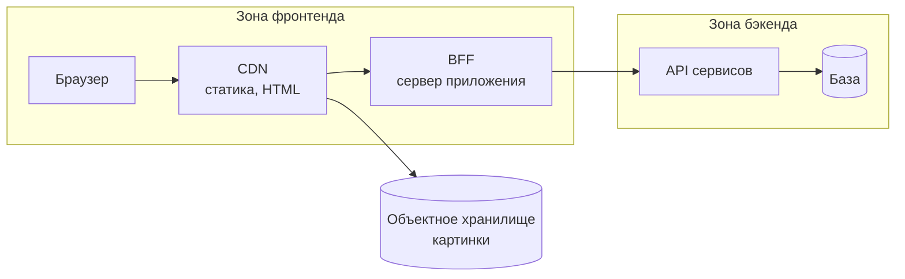
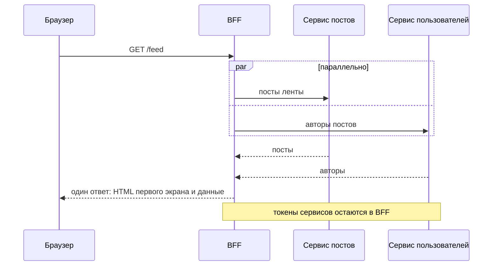

На собеседовании верхний уровень системы — это схема из нескольких блоков и понимание, за что отвечает каждый блок. Фронтенд-разработчик отвечает за клиент и за то, как клиент разговаривает с сервером. Остальное он обсуждает, но не проектирует.

## Типичная схема



| Блок                    | Что делает                                                             | Почему выделен                                       |
| ----------------------- | ---------------------------------------------------------------------- | ---------------------------------------------------- |
| **Клиент**              | Страницы и состояние; SPA или HTML с гидратацией                       | Главная зона ответственности фронтенда               |
| **CDN**                 | Раздаёт статику и кэшированный HTML ближе к пользователю               | Снижает задержку и нагрузку на сервер                |
| **BFF**                 | Серверный слой под один клиент: собирает данные, рендерит первый экран | Скрывает внутренние API и даёт клиенту готовую форму |
| **API сервисов**        | Бизнес-логика и данные, которыми владеют другие команды                | Фронтенд проектирует контракт, а не внутренности     |
| **Объектное хранилище** | Картинки и файлы по ссылке                                             | Байты не идут через API                              |

Провайдер хранилища на интервью второстепенен: назовите роль («S3-подобное хранилище»), а выбор провайдера отложите.

## Зачем BFF

- **Один ответ вместо пяти запросов.** На мобильной сети каждый запрос — это задержка.
- **Клиент не знает о внутренних сервисах.** Меньше связности, проще менять бэкенд.
- **Серверный рендер и секреты** остаются на сервере: токены сервисов в браузер не попадают.



Цена: ещё один сервис для масштабирования и поддержки. Главный риск — BFF разрастается и вбирает бизнес-логику. Альтернатива — API gateway без собственной логики. Выбор зависит от того, сколько клиентов (web, mobile) и насколько различаются их данные.

## Контракт API: что проектирует фронтенд

Фронтенд — потребитель API, поэтому отвечает за качество контракта:

- **Поля под экран.** Не отдавать всё подряд: лишние данные тяжелят ответ и привязывают клиент к внутренней модели.
- **Пагинация.** Курсор для лент, где данные меняются во время чтения; offset для таблиц с переходом по номерам.
- **Ошибки.** Единый формат с кодом, понятным клиенту, и признаком, стоит ли повторять запрос.
- **Совместимость.** Клиенты живут в браузерах днями, поэтому изменения должны быть обратимыми: новые поля добавляются, старые не удаляются сразу.
- **Кэширование.** Какие ответы можно кэшировать (`Cache-Control`, `ETag`), а какие нет.

Пример ответа с курсором:

```json
{ "items": [{ "id": "p1", "title": "…" }], "nextCursor": "p1" }
```

## Выбор стека и его обоснование

Ожидают не «я знаю React», а вопросы: какие варианты есть, что важно для задачи и почему выбран этот. Фреймворк выбирают по экосистеме, поддержке SSR, размеру команды и требованиям к скорости разработки. Язык BFF часто совпадает с языком фронтенда: тогда одна команда и общий код (типы контрактов).

## Граница с бэкендом

Модель данных, шардирование, выбор базы, очереди и расчёт нагрузки — зона бэкенда. Фронтенд-кандидату не нужно считать объём базы. Нужно сказать, что ему важно от бэкенда (задержка, форма ответа, порядок событий) и что он может предложить (BFF, кэш на клиенте, агрегацию).

## Точки выбора

| Точка                     | Альтернативы                 | Вопрос-критерий                                     |
| ------------------------- | ---------------------------- | --------------------------------------------------- |
| Слой между клиентом и API | Нет / BFF / API gateway      | Сколько клиентов и насколько различаются их данные? |
| Место первого рендера     | Клиент / BFF / CDN           | Нужны ли SEO и быстрый первый экран?                |
| Раздача картинок          | Через API / CDN с хранилищем | Каков объём файлов и где пользователи?              |
| Пагинация                 | offset / курсор              | Меняются ли данные, пока пользователь читает?       |

## Что сказать на интервью

«Клиент отдаю через CDN. Первый экран рендерю на BFF, чтобы страница приходила с контентом и индексировалась. BFF собирает данные из двух сервисов в один ответ и скрывает их API. Картинки лежат в объектном хранилище и раздаются через CDN, чтобы не нагружать API. Форму ответа и курсорную пагинацию согласую с бэкендом».
